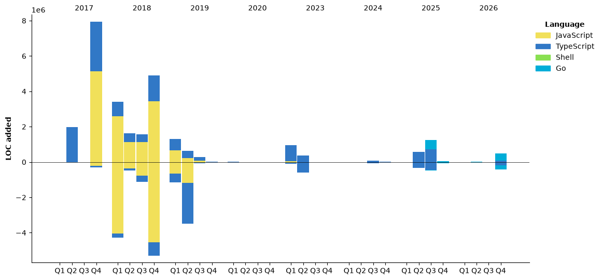

<h1 align="center">Hi 👋, I'm James W Lane</h1>
<h3 align="center">As an Agile Coach, Product Manager, Engineering Manager, and Full-Stack Software Engineer, I bring a diverse skill set to the table and am ready to tackle any challenge.</h3>
<h3 align="center">I'm here and ready to collaborate if you have any questions or are interested in launching 🚀 a project together.</h3>

<div style="margin-top: 16px;" />

<h3 align="center">📫 You can reach me by email at info 'at' jameswlane 'dot' com</h3>

<div style="margin-top: 48px;" />

[](https://www.linkedin.com/in/jameswlane/)
[](https://x.com/jameswlane)
[](https://www.jameswlane.com)

<div style="margin-top: 48px;" />

- 🔭 I'm currently working on:
  - DevEx - A shell script for setting up a Linux development environment.
  - Scylax - A GitHub application for tracking value delivery from teams.
- 🌱 I'm currently learning:
  - On training and building AI-powered applications.
- 👯 I'm looking to collaborate on anything to help improve the team's value delivery.

### Experience & tools I use:

My experience spans the development of web and terminal applications, providing me with a comprehensive understanding of these domains.

My tools:
- Web >> Next.js, TypeScript, Ruby on Rails, and Python
- APIs >> REST & GraphQL
- DevOps >> Docker, Kubernetes, Helm, Prometheus, Grafana, Ansible

[🔭 Find out what I’m currently working on](https://www.jameswlane.com/now)  

<div style="margin-top: 50px;"/>

### The summary of my repos:
- [DevEx](https://github.com/jameswlane/devex)  

### For the stat nerds:
[](https://git.io/streak-stats)
[](https://github-readme-stats.vercel.app)
[](https://github-readme-stats.vercel.app)

<!--START_SECTION:waka-->


**🐱 My GitHub Data** 

> 📦 129.6 kB Used in GitHub's Storage 
 > 
> 🏆 542 Contributions in the Year 2026
 > 
> 💼 Opted to Hire
 > 
> 📜 11 Public Repositories 
 > 
> 🔑 7 Private Repositories 
 > 
**I'm an Early 🐤** 

```text
🌞 Morning                14707 commits       ██████░░░░░░░░░░░░░░░░░░░   25.76 % 
🌆 Daytime                18594 commits       ████████░░░░░░░░░░░░░░░░░   32.57 % 
🌃 Evening                20707 commits       █████████░░░░░░░░░░░░░░░░   36.27 % 
🌙 Night                  3084 commits        █░░░░░░░░░░░░░░░░░░░░░░░░   05.40 % 
```
📅 **I'm Most Productive on Thursday** 

```text
Monday                   6753 commits        ███░░░░░░░░░░░░░░░░░░░░░░   11.83 % 
Tuesday                  5609 commits        ██░░░░░░░░░░░░░░░░░░░░░░░   09.82 % 
Wednesday                9743 commits        ████░░░░░░░░░░░░░░░░░░░░░   17.07 % 
Thursday                 11324 commits       █████░░░░░░░░░░░░░░░░░░░░   19.83 % 
Friday                   9680 commits        ████░░░░░░░░░░░░░░░░░░░░░   16.96 % 
Saturday                 7221 commits        ███░░░░░░░░░░░░░░░░░░░░░░   12.65 % 
Sunday                   6762 commits        ███░░░░░░░░░░░░░░░░░░░░░░   11.84 % 
```


📊 **This Week I Spent My Time On** 

```text
🕑︎ Time Zone: America/Chicago

💬 Programming Languages: 
Markdown                 4 hrs 37 mins       ████████████░░░░░░░░░░░░░   49.37 % 
Go                       1 hr 37 mins        ████░░░░░░░░░░░░░░░░░░░░░   17.40 % 
TypeScript               1 hr 20 mins        ████░░░░░░░░░░░░░░░░░░░░░   14.33 % 
Python                   45 mins             ██░░░░░░░░░░░░░░░░░░░░░░░   08.12 % 
Other                    21 mins             █░░░░░░░░░░░░░░░░░░░░░░░░   03.78 % 

🔥 Editors: 
Claude Code              5 hrs 29 mins       ███████████████░░░░░░░░░░   58.71 % 
Codex CLI                1 hr 48 mins        █████░░░░░░░░░░░░░░░░░░░░   19.36 % 
Webstorm                 1 hr 18 mins        ████░░░░░░░░░░░░░░░░░░░░░   14.03 % 
GoLand                   34 mins             ██░░░░░░░░░░░░░░░░░░░░░░░   06.12 % 
WebStorm                 8 mins              ░░░░░░░░░░░░░░░░░░░░░░░░░   01.57 % 

💻 Operating System: 
Linux                    9 hrs 21 mins       █████████████████████████   100.00 % 
```

🤖 **AI Coding This Week** 

```text
⏱ AI Coding Time: 8 hrs 46 mins (93.84%)

✍️ 5,135 lines written by AI, 15 lines written by hand (99.71% AI-written)

🔤 8,124,935 Input Tokens, 2,007,611 Output Tokens

💵 $347.92 Estimated AI Cost This Week

🧠 53 AI Sessions, 275 AI Prompts

Opus                     2,878 lines         ██████████████░░░░░░░░░░░   55.11 % 
GPT                      1,696 lines         ████████░░░░░░░░░░░░░░░░░   32.48 % 
K                        648 lines           ███░░░░░░░░░░░░░░░░░░░░░░   12.41 % 
Kimi-Code                0 lines             ░░░░░░░░░░░░░░░░░░░░░░░░░   00.00 % 

🔎 AI Coding Insights:
🤖 AI-Driven — 99.71% of written lines came from AI
📚 Verbose Prompter — average 2,728 characters per prompt
🔁 Iterative Prompter — average 5 prompts per session
🚀 High AI Trust — 0.32% of changed lines were hand-edited
```

**I Mostly Code in TypeScript** 

```text
TypeScript               11 repos            ██████████████░░░░░░░░░░░   55.00 % 
JavaScript               4 repos             █████░░░░░░░░░░░░░░░░░░░░   20.00 % 
Shell                    3 repos             ████░░░░░░░░░░░░░░░░░░░░░   15.00 % 
Go                       2 repos             ██░░░░░░░░░░░░░░░░░░░░░░░   10.00 % 
```


**Timeline**




 Last Updated on 01/11/2026 03:48:51 UTC
<!--END_SECTION:waka-->
